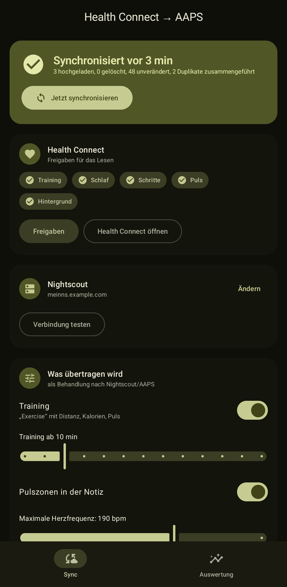
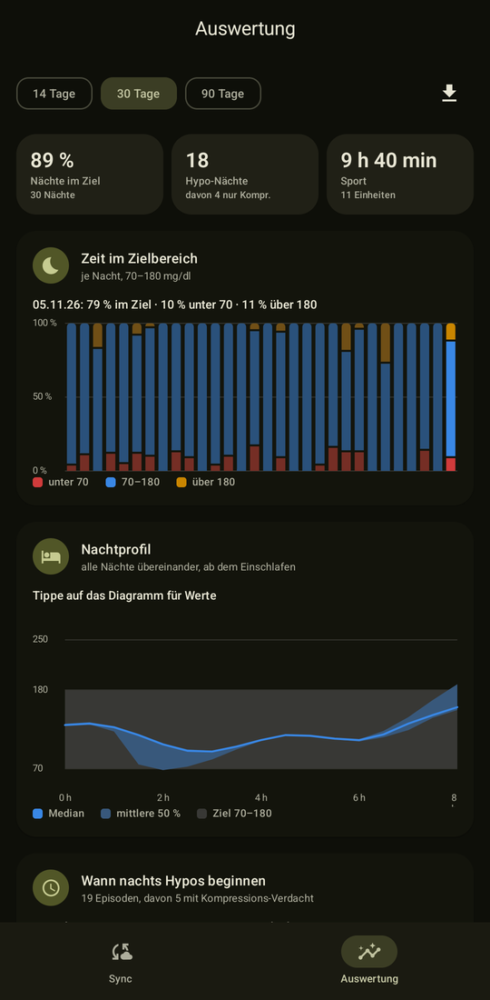
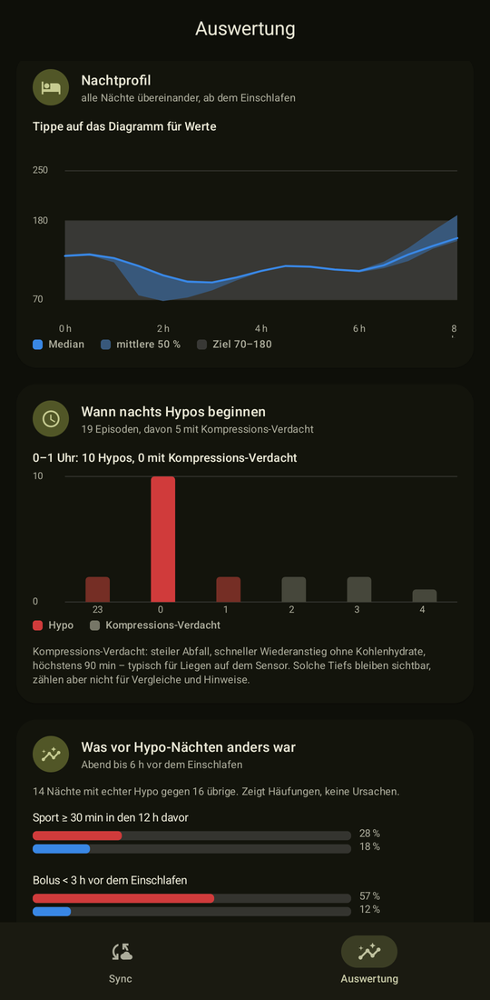
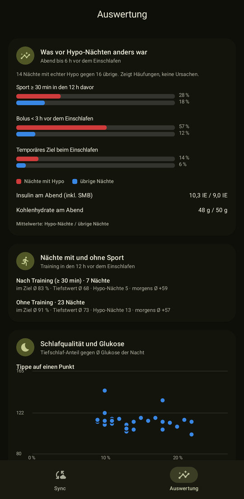
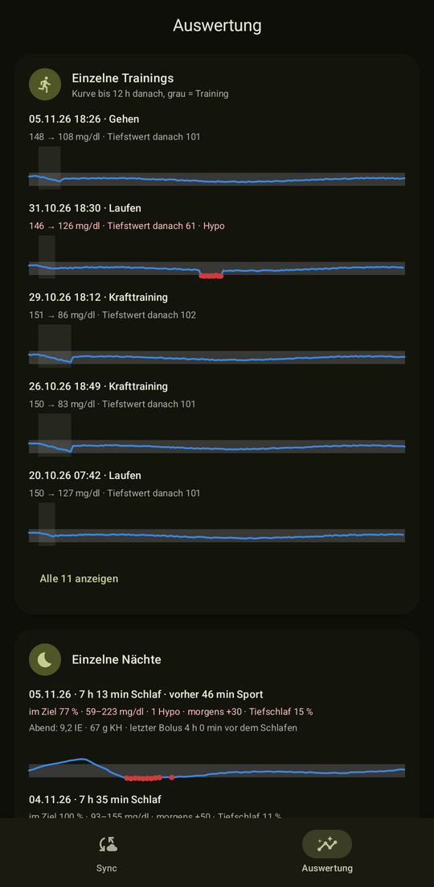
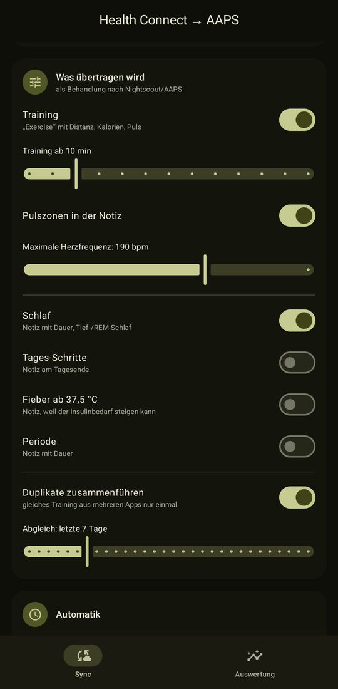
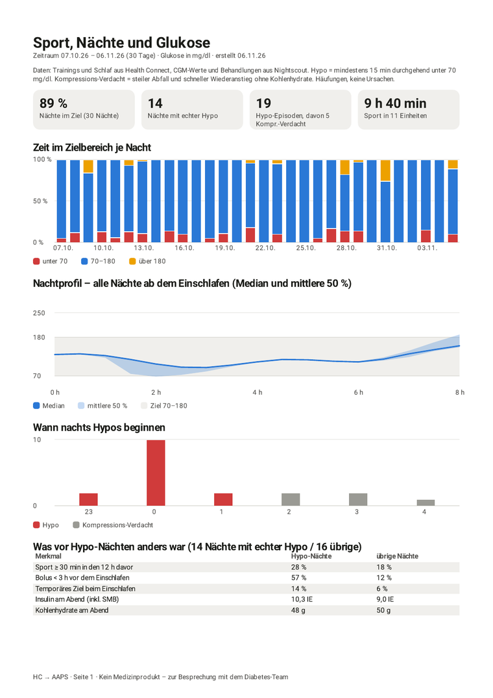

# HC → AAPS

**Trainings, Schlaf und weitere Daten aus Health Connect automatisch in Nightscout – sichtbar in AAPS 4.**
Dazu eine Auswertung, wie sich Sport und Nächte auf deine Glukose auswirken.

[](LICENSE)


> [!IMPORTANT]
> **Kein Medizinprodukt.** Die App ist ein privates Open-Source-Projekt ohne Zulassung. Sie schreibt nur
> Notizen und Sport-Einträge nach Nightscout und gibt Hinweise – sie setzt nie selbst Ziele, Boli oder
> andere Therapie-Einstellungen in AAPS. Entscheidungen über deine Therapie triffst du, am besten mit
> deinem Diabetes-Team. Nutzung auf eigene Verantwortung.

<p align="center">
  
  
  
</p>
<p align="center">
  
  
  
</p>
<p align="center">
  
</p>
<p align="center"><sub>Screenshots mit erfundenen Demo-Daten.</sub></p>

## Inhalt

- [Funktionen](#funktionen)
- [Datenschutz](#datenschutz)
- [Voraussetzungen](#voraussetzungen)
- [Einrichtung](#einrichtung)
- [Was nach Nightscout geschrieben wird](#was-nach-nightscout-geschrieben-wird)
- [Auswertung](#auswertung)
- [Benachrichtigungen](#benachrichtigungen)
- [Wie der Sync funktioniert](#wie-der-sync-funktioniert)
- [Bauen und entwickeln](#bauen-und-entwickeln)
- [Lizenz](#lizenz)

## Funktionen

**Sync nach Nightscout/AAPS**
- Trainings mit Distanz, Kalorien, Ø/max Puls, Schritten und Pulszonen
- Schlaf mit Dauer und Schlafphasen
- optional Tagesschritte, Fieber ab 37,5 °C, Periode und ein Infekt-Hinweis bei auffälligem Ruhepuls/HRV
- doppelte Einträge mehrerer Apps (z. B. Garmin und Samsung Health) werden zusammengeführt
- alle 15 min im Hintergrund, optional nur über WLAN und/oder nur beim Laden; Kachel in den Schnelleinstellungen

**Auswertung**
- Zeit im Zielbereich je Nacht, Nachtprofil (AGP-ähnlich), Sport und Glukose
- Hypo-Episoden nach internationalem Konsens, Erkennung von Kompressions-Tiefs
- „Was vor Hypo-Nächten anders war“: Sport, später Bolus, temporäres Ziel, Insulin am Abend
- „Wirkt das temporäre Ziel?“ – Nächte nach Sport mit und ohne geplantes Ziel
- Schlafqualität, Uhrzeit des Trainings, Ruhepuls und HRV
- **PDF-Bericht** und CSV-Export für die Sprechstunde, Anzeige wahlweise in mg/dl oder mmol/l

**Hinweise** (nur Benachrichtigungen, nie Eingriffe)
- vor dem Schlafengehen, wenn der Abend früheren Hypo-Nächten ähnelt
- nach langem Training, Wochenbericht, Sync-Fehler
- **Widget** für den Startbildschirm: letzte Nacht im Ziel, Hypo-Episoden, letzter Sync

## Datenschutz

- **Blutzucker aus Health Connect wird nie gelesen oder übertragen.** Die App fragt dafür nicht einmal eine
  Berechtigung an.
- Daten gehen **ausschließlich an deine eigene Nightscout-Instanz**. Keine Werbung, keine Analyse-Dienste,
  keine weiteren Server.
- Die Auswertung liest CGM-Werte und Behandlungen aus Nightscout und zeigt sie nur in der App an.
- Das Nightscout-Token wird mit einem Schlüssel aus dem Android Keystore verschlüsselt gespeichert;
  App-Backups sind abgeschaltet.

## Voraussetzungen

| | |
|---|---|
| Android | 9 oder neuer, mit [Health Connect](https://play.google.com/store/apps/details?id=com.google.android.apps.healthdata) (ab Android 14 eingebaut) |
| Nightscout | Version 15 oder neuer (API v3) |
| AAPS | getestet mit 4.0.0, NSClient **v3** |
| Datenquellen | jede App, die nach Health Connect schreibt – z. B. Garmin Connect, Samsung Health, Fitbit, Google Fit, Oura, Withings, Polar |

## Einrichtung

### 1. Zugriffstoken in Nightscout anlegen

Unter **Admin-Werkzeuge** in deinem Nightscout:

1. **Neue Rolle** anlegen, z. B. `healthconnect`, mit den Berechtigungen (durch Leerzeichen getrennt):
   ```
   api:treatments:* api:entries:read
   ```
   `api:treatments:*` braucht der Sync (anlegen, ändern, löschen, lesen), `api:entries:read` nur die Auswertung.
2. **Neues Subjekt** anlegen, z. B. `healthconnect`, mit dieser Rolle, und dessen **Zugriffstoken** kopieren
   (sieht aus wie `healthconnect-1a2b3c4d…`).

> [!NOTE]
> Die Standardrolle **careportal reicht nicht** – sie darf nur anlegen, nicht ändern oder löschen, und
> Nightscout antwortet dann mit HTTP 403. Das **API_SECRET** funktioniert mit API v3 nicht.
> „Verbindung testen“ in der App zeigt fehlende Rechte einzeln an.

### 2. App einrichten

1. App installieren (siehe [Bauen](#bauen-und-entwickeln)).
2. Nightscout-URL und Token eintragen, **Verbindung testen**.
3. **Freigaben** antippen und Training, Schlaf usw. sowie **Hintergrund-Lesen** erlauben.
   Ohne Hintergrund-Lesen läuft der Sync nur, solange die App geöffnet ist.

### 3. AAPS einstellen

*Konfiguration → Synchronisierung → NSClient (v3) → Einstellungen → Synchronisierung:*
**„Therapie-Ereignisse übernehmen“** einschalten. Danach erscheinen Trainings und Notizen im Verlauf und in der Grafik.

## Was nach Nightscout geschrieben wird

| Health Connect | Nightscout-Treatment | in AAPS 4 |
|---|---|---|
| Trainingseinheit | `Exercise` mit Dauer – „Laufen · 8,4 km · 612 kcal · Ø 151 / max 174 bpm · Zonen Z2 9 / Z3 24 / Z4 12 min (Garmin Connect)“ | Sport |
| Schlafsitzung | `Note` mit Dauer – „Schlaf 7 h 12 min (Tief 1 h 24 min, REM 1 h 41 min, wach 18 min)“ | Notiz |
| Tagesschritte *(optional)* | `Note` am Tagesende, erst nach Abschluss des Tages – „Schritte 05.11.: 9.842“ | Notiz |
| Körpertemperatur ≥ 37,5 °C *(optional)* | `Note` – „Erhöhte Temperatur 38,2 °C (Ohr) – Insulinbedarf kann steigen“ | Notiz |
| Periode *(optional)* | `Note` mit Dauer – „Periode, Tag 1–5“ | Notiz |
| Ruhepuls und HRV *(optional)* | `Note` nur bei deutlicher Abweichung – „Ruhepuls erhöht: 62 bpm (sonst 54) · HRV 29 ms (sonst 44) – möglicher Infekt, Insulinbedarf kann steigen“ | Notiz |

Puls, Distanz und Schritte stehen **in der Trainingsnotiz**: Als eigene Messreihen liest AAPS 4 sie nicht aus
Nightscout (nur von Wear OS bzw. Garmin direkt).

## Auswertung

Tab **Auswertung**, Zeitraum 14, 30 oder 90 Tage. Diagramme lassen sich antippen, um genaue Werte zu sehen.

| Bereich | Was es zeigt |
|---|---|
| Kennzahlen | Nächte im Ziel, Hypo-Nächte (davon nur Kompression), Sportzeit |
| Zeit im Zielbereich | gestapelte Balken je Nacht: unter 70 / 70–180 / über 180 mg/dl |
| Nachtprofil | alle Nächte ab dem Einschlafen übereinander – Median und mittlere 50 % |
| Wann nachts Hypos beginnen | Histogramm nach Uhrzeit, Kompressions-Verdacht getrennt |
| Was vor Hypo-Nächten anders war | Nächte mit echter Hypo gegen übrige: Sport, Bolus < 3 h vor dem Schlafen, temporäres Ziel, Insulin und Kohlenhydrate am Abend |
| Wirkt das temporäre Ziel? | Nächte nach Sport mit und ohne **geplantes** Ziel (z. B. „Activity“); Ziele aus Automationen oder wegen Hypo bleiben außen vor |
| Nächte mit und ohne Sport | Training in den 12 h vor dem Einschlafen im Vergleich |
| Schlafqualität | Tiefschlaf-Anteil gegen Ø Nachtglukose |
| Uhrzeit des Trainings | Anteil mit Hypo in den 12 h danach, morgens/mittags/abends/spät |
| Ruhepuls und HRV | Verlauf je Tag, auffällige Tage markiert, Nächte danach im Vergleich |
| Einzelne Trainings und Nächte | kleine Glukosekurve, bei Nächten mit dem Abend davor |
| PDF-Bericht | zwei A4-Seiten für die Sprechstunde: Kennzahlen, Zeit im Ziel je Nacht, Nachtprofil, Hypo-Uhrzeiten, Vergleiche, Nachtliste |
| CSV-Export | alle Werte als Tabelle (Semikolon, UTF-8), öffnet direkt in Excel/LibreOffice |

Glukose wird wahlweise in **mg/dl oder mmol/l** angezeigt (Einstellung „Anzeige“); intern rechnet die App in mg/dl wie Nightscout.

**Definitionen**
- **Hypo-Episode:** mindestens 15 min durchgehend unter 70 mg/dl (internationaler Konsens). Einzelne Ausreißer zählen nicht.
- **Kompressions-Verdacht:** Abfall ≥ 30 mg/dl in 15 min, Wiederanstieg ≥ 30 mg/dl in 20 min, höchstens 90 min,
  keine Kohlenhydrate in der Zeit – typisch für Liegen auf dem Sensor. Solche Tiefs bleiben sichtbar, zählen aber
  nicht für Vergleiche und Hinweise.
- **Abend:** die 6 h vor dem Einschlafen. **Später Bolus:** selbst ausgelöst (kein SMB), weniger als 3 h vor dem Einschlafen.
- **Geplantes Ziel:** temporäres Ziel ohne den Grund „Automation“ oder „Hypo“ – diese sind eine Reaktion auf fallende Werte.
- **Auffälliger Tag (Ruhepuls/HRV):** Ruhepuls mindestens 5 bpm über dem Median der 14 Tage davor, oder mindestens 3 bpm
  darüber zusammen mit HRV ≤ 75 % des Normalwerts oder Fieber.

Die Auswertung zeigt **Häufungen, keine Ursachen.** Ein temporäres Ziel, das eine AAPS-Automation bei fallender
Glukose setzt, taucht zum Beispiel gehäuft in Hypo-Nächten auf – als Reaktion, nicht als Auslöser.

Die Diagrammfarben (Rot/Blau/Gelb statt Rot/Grün) sind mit einem Palette-Validator geprüft und auch bei
Rot-Grün-Sehschwäche unterscheidbar; jede Grafik hat eine Legende und die Werte zusätzlich als Text.

## Benachrichtigungen

| Hinweis | Wann |
|---|---|
| Vor dem Schlafengehen | etwa 30 min vor deiner gelernten Einschlafzeit, **nur** wenn heute Sport (≥ 30 min) oder ein später Bolus war **und** du nach solchen Abenden deutlich öfter eine echte Hypo-Nacht hattest (≥ 50 % und 20 Prozentpunkte mehr als sonst, je mindestens 3 Nächte) |
| Nach dem Training | nach einem frisch übertragenen Training ab einstellbarer Dauer (Standard 45 min), mit der eigenen Vorgeschichte |
| Wochenbericht | sonntags 19 Uhr: Nächte im Ziel (mit Vorwoche), Hypo-Nächte, Sportzeit |
| Sync-Fehler | sofort bei Token- oder Rechteproblemen, bei Netzwerkfehlern ab dem dritten Fehlschlag in Folge |

Alle Hinweise sind einzeln abschaltbar.

## Wie der Sync funktioniert

- Bei jedem Lauf wird das Zeitfenster der letzten *n* Tage (Standard 7) aus Health Connect gelesen.
- Jeder Eintrag bekommt einen stabilen `identifier` (UUID aus der Health-Connect-Record-ID) und wird per
  `PUT /api/v3/treatments/{identifier}` geschrieben – wiederholte Läufe erzeugen keine Duplikate.
- Nur geänderte Einträge werden hochgeladen. Trainings werden 48 h lang neu berechnet, weil Uhren Puls und
  Distanz oft verspätet liefern.
- In Health Connect gelöschte Einträge werden in Nightscout gelöscht; AAPS übernimmt das.
- Löschst du einen Eintrag in AAPS oder Nightscout, merkt sich die App das (HTTP 410) und legt ihn nicht neu an.
- Überlappen sich Sitzungen verschiedener Apps zu mindestens 50 %, wird nur die längste übertragen.
- Vor jedem Lauf werden die Rechte des Tokens geprüft. Fehlt nur `delete`, wird hochgeladen, aber nichts gelöscht.

<details>
<summary>Format eines Trainings in Nightscout</summary>

```json
{
  "identifier": "8c6f0a6e-…",
  "eventType": "Exercise",
  "date": 1762358400000,
  "created_at": "2026-11-05T16:00:00Z",
  "utcOffset": 60,
  "duration": 45,
  "durationInMilliseconds": 2700000,
  "notes": "Laufen · 7,3 km · 512 kcal · Ø 148 / max 171 bpm (Garmin Connect)",
  "enteredBy": "Health Connect",
  "app": "aaps-health-connect",
  "isValid": true
}
```
</details>

## Bauen und entwickeln

Benötigt JDK 17+ und das Android SDK (compileSdk 36).

```bash
./gradlew :app:assembleDebug          # APK: app/build/outputs/apk/debug/app-debug.apk
./gradlew :app:testDebugUnitTest      # Unit-Tests
./gradlew :app:lintDebug              # Lint
```

Für eigene Release-Builds einen eigenen Signaturschlüssel verwenden.

**Demo-Modus** (nur Debug-Builds, erfundene Daten – für Screenshots und Vorführungen; es wird nichts
gespeichert oder synchronisiert):

```bash
adb shell am start -S -n de.nbeck.aapshc/.ui.MainActivity --ez demo true --ei tab 1
```

Mit `--ez pdf true` schreibt der Demo-Modus zusätzlich einen Beispiel-Bericht nach `cache/demo-bericht.pdf`
(abholen mit `adb exec-out run-as de.nbeck.aapshc cat cache/demo-bericht.pdf > bericht.pdf`).

**Aufbau**

| Paket | Inhalt |
|---|---|
| `hc` | Lesen aus Health Connect |
| `ns` | Nightscout-API-v3-Client, Rechteprüfung |
| `sync` | Sync, Abbildung auf Treatments, Auswertungen, Worker, Benachrichtigungen |
| `ui` | Compose-Oberfläche und Diagramme |

Beiträge sind willkommen – Issues und Pull Requests gern auf Deutsch oder Englisch. Bitte keine echten
Gesundheitsdaten in Issues, Logs oder Screenshots posten.

## Lizenz

[GNU General Public License v3.0](LICENSE) – du darfst die App nutzen, ändern und weitergeben; veränderte
Versionen müssen ebenfalls unter der GPL-3.0 offengelegt werden. Ohne Gewährleistung.

„Health Connect“ ist eine Marke von Google. Dieses Projekt steht in keiner Verbindung zu Google, zum
AndroidAPS- oder zum Nightscout-Projekt.
